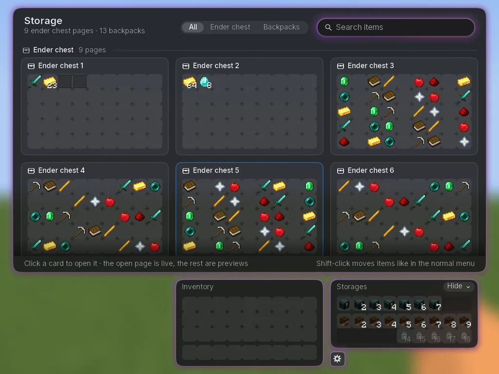
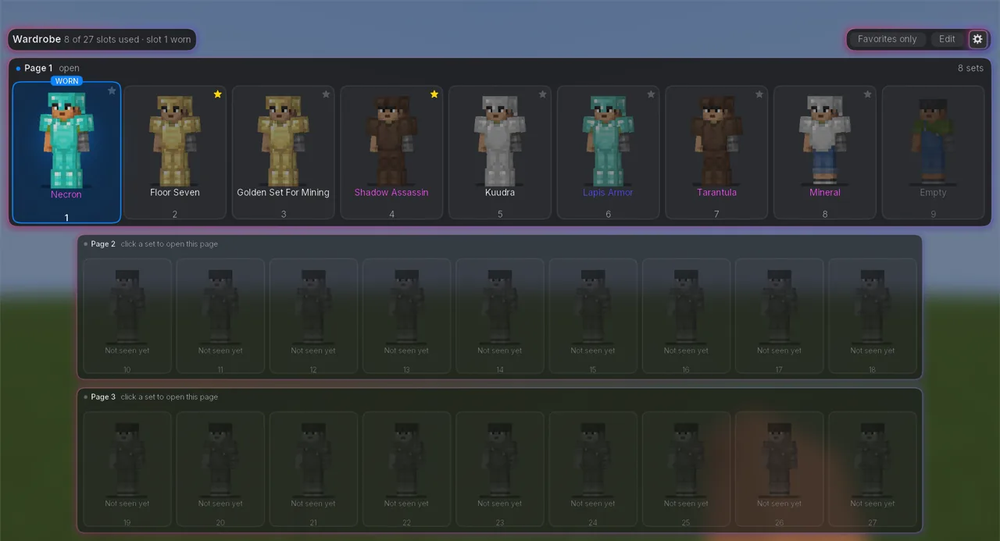
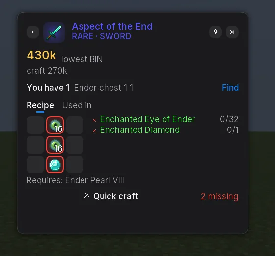

# Lumio: Hypixel SkyBlock

Panels, trackers and helpers for Hypixel SkyBlock, in the look of [Lumio](https://github.com/tim1337xd/Lumio).

**Version 1.0.0 Beta.** Things may still change. [Feedback is welcome](https://github.com/tim1337xd/Lumio-SkyBlock/issues).

Inspired by [SkyHanni](https://github.com/hannibal002/SkyHanni) and [SkySoft](https://modrinth.com/mod/skysoft). Both are great, so check them out too.

## Features

**Overlays**
- **Storage**: all ender chest pages and backpacks at once, with a search.
- **Wardrobe**: your character wearing every armor set, all pages at once.
- **Item search**: recipes, drops, shops, prices and the wiki for every item.

**Panels and trackers**
- **Panels**: pet (and the equipped pet highlighted in the Pets menu), equipment, deployables and arrows.
- **Profit trackers**: mining, farming, slayers, fishing, corpses, experiments and dragons.
- **Slayer**: boss phases, highlights, drops and miniboss alerts.

**Helpers**
- **Mining**: commissions, Mineshaft pity, corpses, abilities, the HOTM tree, Break Reset Fix.
- **Farming and fishing**: pests, visitors, sea creatures and a mouse lock in the Garden.
- **Experimentation Table**: solver for Chronomatron, Ultrasequencer and Superpairs, with optional blocking of wrong clicks.
- **Item protection**: your best items can't be dropped or sold by accident.

**More**
- Tooltip lines with prices and dungeon quality, enchant colors.
- A SkyBlock chat tab, drop toasts and command suggestions.
- A custom scoreboard, SkyBlock info in the info bar and the tab list.
- Etherwarp, Keep Terrain Loaded and a Grappling Hook timer.

## Installation

You need [Lumio](https://github.com/tim1337xd/Lumio) 1.0.0-beta.1 or newer, with what it needs (Minecraft 26.2 or 26.3, Fabric Loader, Fabric
API, Java 25).

Download the jar for your Minecraft version from the [releases page](https://github.com/tim1337xd/Lumio-SkyBlock/releases):

| Minecraft | Jar |
| --- | --- |
| 26.2 | `lumio-skyblock-1.0.0-beta.1+mc26.2.jar` |
| 26.3 | `lumio-skyblock-1.0.0-beta.1+mc26.3.jar` |

Put it into your `mods` folder beside Lumio and start the game. It shows up in Lumio's menu under Add-ons.

## Known issues

- Minecraft 26.3 can crash while starting (`EXCEPTION_ACCESS_VIOLATION`). This is the game, not Lumio. The Java option
  `-XX:StackShadowPages=32` avoids it. Some launchers, such as Prism, already add it.
- On Minecraft 26.3, mining on Hypixel can restart the block breaking. This also happens without mods; 26.2 isn't affected.

## Privacy

Prices and item data come from the Hypixel API, the NotEnoughUpdates repository and price services.
[CREDITS.md](CREDITS.md) lists each one and what it receives. Your account is never sent anywhere.

## Using it on Hypixel

Everything is client-side and visual or informational. There is no automation.
A few buttons and overlay clicks send exactly one click or command, as if you did it yourself.
The experiment helper may send your own matching click as a middle click, so the item never lands on the cursor; it never clicks by itself.
Item protection and the optional blocking of wrong clicks only hold back your own clicks.

Hypixel does not approve any mod. You use every modification at your own risk.

## Credits and license

See [CREDITS.md](CREDITS.md) for credits and online services, and [CHANGELOG.md](CHANGELOG.md) for changes.

Licensed under the [GPL-3.0](LICENSE), like Lumio. Not affiliated with Mojang, Microsoft or Hypixel.
