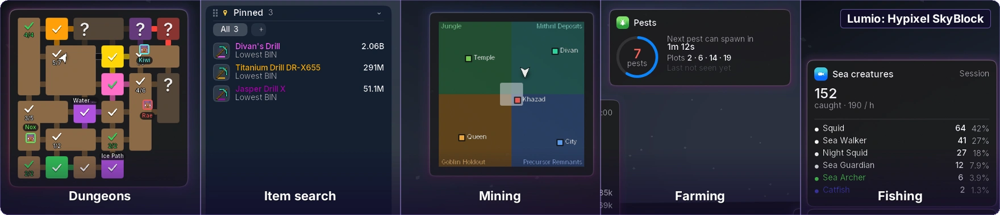
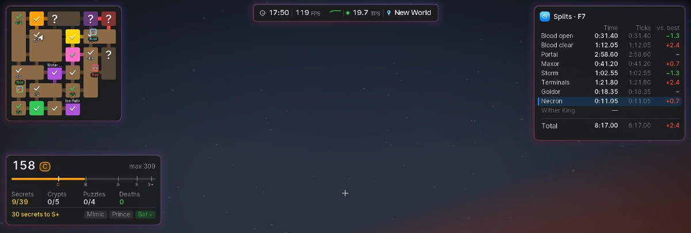
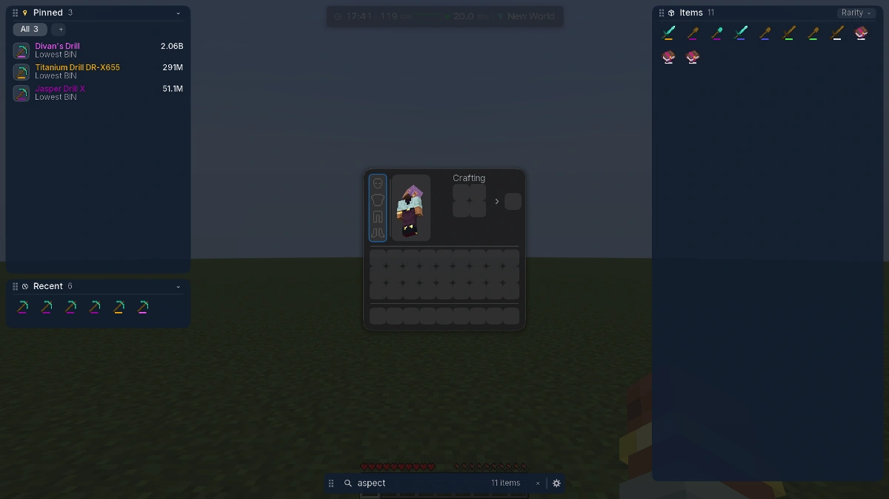
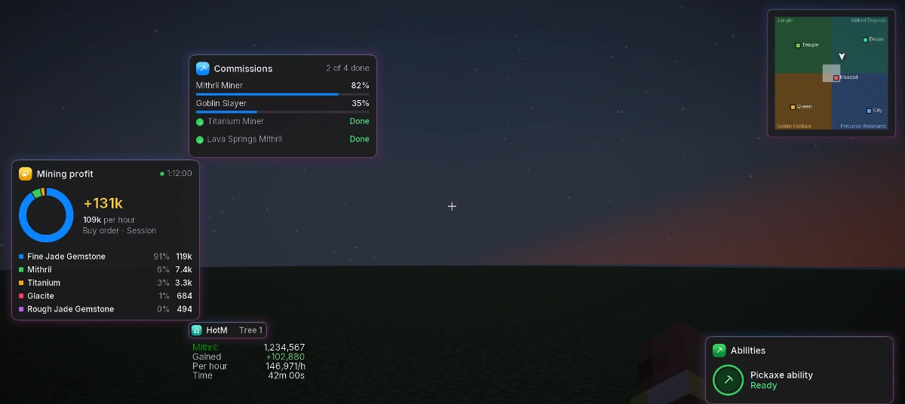
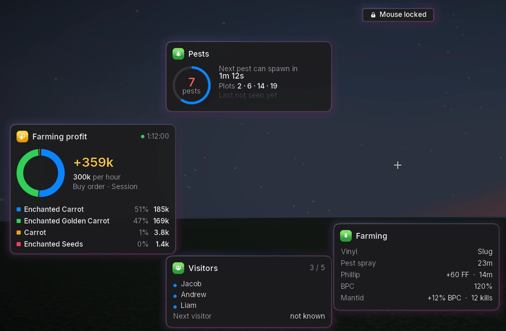
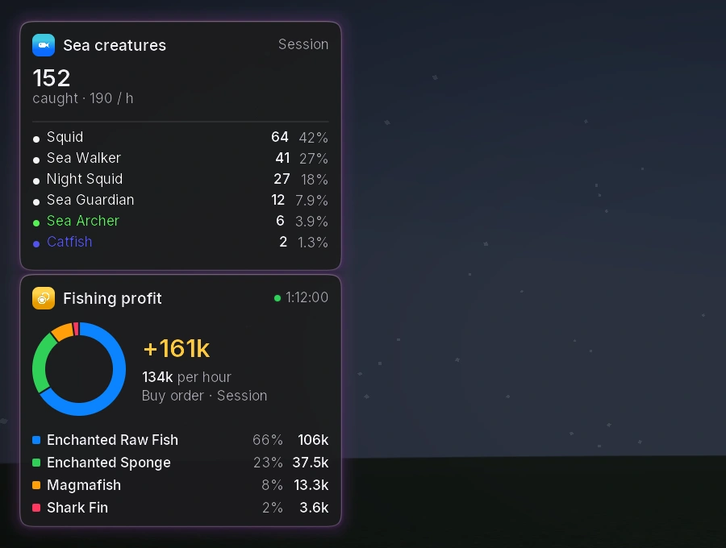
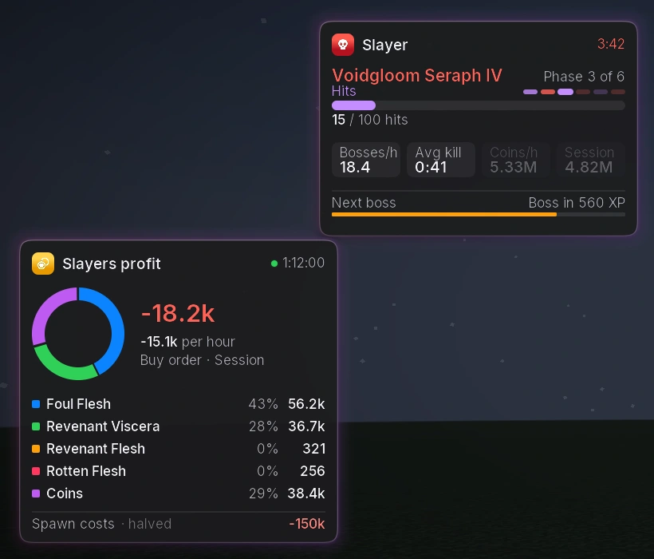
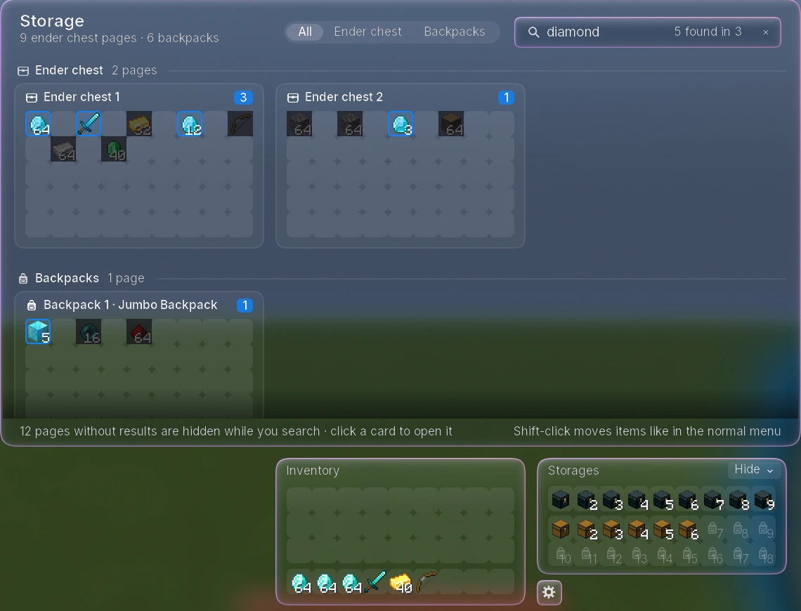

# Lumio: Hypixel SkyBlock

SkyBlock helpers in the Lumio look: dungeons, items, mining, farming and fishing.

**[Download from GitHub Releases](https://github.com/tim1337xd/Lumio-SkyBlock/releases)** · [Lumio](https://github.com/tim1337xd/Lumio) · [Changelog](CHANGELOG.md)

<picture><source media="(prefers-color-scheme: light)" srcset="docs/readme/divider-light.png"></picture>

## Install

1. Install [Lumio](https://github.com/tim1337xd/Lumio) first.
   On Minecraft 26.3, also add `-XX:StackShadowPages=32` to the Java arguments in your launcher, as in Lumio's install steps: Minecraft 26.3 itself can crash while starting on some PCs without it.
2. Put the add-on's jar for your Minecraft version into your `mods` folder, beside Lumio.
3. Start the game: the add-on is in Lumio's menu under SkyBlock.

Coming from Beta 1? Replace the old jar by hand once; from Beta 2 on, Lumio tells you about new versions itself.

<picture><source media="(prefers-color-scheme: light)" srcset="docs/readme/divider-light.png"></picture>

## Features

<b>Dungeons</b> · map, score, splits, F7 helpers

- A clean map of the rooms the game's map shows, with checkmarks, doors and secrets.
- The score with its rank and what it can still reach, and every phase timed against your best run.
- Puzzle hints, a leap overlay, timers for masks and the Phoenix, and F7 terminal and device helpers.
- Highlights only for what you can see.

<b>Item search</b> · search, prices, recipes, wiki

- Calm panels around your inventory: search, Pinned and Recent, moved by their grip.
- Every item with its recipe, drops, prices and a link to the wiki.
- Matches light up in your inventory.

<b>Mining</b> · commissions, powder, Crystal Hollows map

- Commissions, abilities, the Heart of the Mountain tree and Mineshaft pity.
- A Crystal Hollows map with the places found in your lobby.
- The Powder Helper with treasure chest timers, and corpses in the Glacite Mineshafts.

<b>Farming</b> · pests, visitors, farming keys

- Pests with the next spawn and their plots, and a glow on the pests you can see.
- Visitors, the pest spray and your farming stats in one panel.
- A mouse lock and your own farming keys while you farm in the Garden (off at first).

<b>Fishing</b> · sea creatures, hotspots, alerts

- Every sea creature counted, with double hooks, shares and rare ones on hover.
- Alerts for rare catches, yours and your party's.
- A hotspot helper that puts a waypoint where the radar's trail leads.

<b>Profit and trackers</b> · what you earn per hour

- Profit for mining, farming, slayers, fishing, corpses, experiments and dragons.
- Only what comes in from outside counts, never crafting or moving items.
- Slayer phases, highlights and miniboss alerts.

<b>Inventory and storage</b> · storage, wardrobe, buttons

- All ender chest pages and backpacks at once, with a search.
- The wardrobe with your character wearing every set, and keys for your loadouts.
- Your own command buttons around the inventory, favorite items and slot binds.

<picture><source media="(prefers-color-scheme: light)" srcset="docs/readme/divider-light.png"></picture>

## Fair play

The add-on shows and highlights what the game already shows you. It never plays for you: one action per key press or click, no
automation.

<picture><source media="(prefers-color-scheme: light)" srcset="docs/readme/divider-light.png"></picture>

## Questions

<b>Is it allowed on Hypixel?</b>

It keeps to Hypixel's rules on allowed modifications: client-side, visual or informational, no automation.
Hypixel does not approve any mod, so you use every modification at your own risk.

<b>Does it work without Lumio?</b>

No. The add-on is built on Lumio and draws everything in its look; install Lumio first.

<b>Where do the prices come from?</b>

Auction prices from [SkyCofl](https://sky.coflnet.com), bazaar prices from the Hypixel API, item data from the NotEnoughUpdates repository.
Only the item is sent, nothing about you. [CREDITS.md](CREDITS.md) lists each source.

**Updates:** Lumio asks GitHub once per start whether a newer version exists; nothing is downloaded without a click.

<picture><source media="(prefers-color-scheme: light)" srcset="docs/readme/divider-light.png"></picture>

[Credits](CREDITS.md) · [GPL-3.0](LICENSE) · [Report a bug](https://github.com/tim1337xd/Lumio-SkyBlock/issues) · Not affiliated with Mojang, Microsoft or Hypixel.
