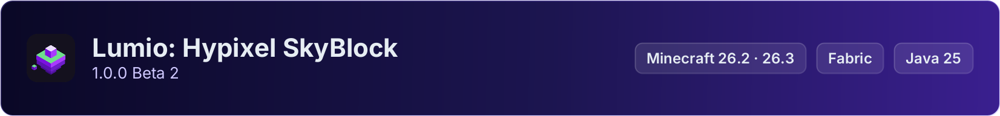

Second beta: dungeons, the Party Finder Helper, fishing alerts and a calmer item search.

> [!IMPORTANT]
> Coming from Beta 1? Install this one by hand once: replace the old jar. From Beta 2 on, Lumio tells you about new versions itself.

## Download

| Minecraft | File | Needs |
|---|---|---|
| 26.3 | [lumio-skyblock-1.0.0-beta.2-26.3.jar](https://github.com/tim1337xd/Lumio-SkyBlock/releases/download/v1.0.0-beta.2/lumio-skyblock-1.0.0-beta.2-26.3.jar) | Fabric API 0.165.0+26.3 and [Lumio 1.0.0 Beta 2](https://github.com/tim1337xd/Lumio/releases/tag/v1.0.0-beta.2) |
| 26.2 | [lumio-skyblock-1.0.0-beta.2-26.2.jar](https://github.com/tim1337xd/Lumio-SkyBlock/releases/download/v1.0.0-beta.2/lumio-skyblock-1.0.0-beta.2-26.2.jar) | Fabric API 0.161.0+26.2 and [Lumio 1.0.0 Beta 2](https://github.com/tim1337xd/Lumio/releases/tag/v1.0.0-beta.2) |

Fabric Loader 0.20.1 or newer and Java 25.

## Highlights

- **Dungeons**: map, score, splits, puzzle solvers, practice; F7/M7 in progress.
- **Party Finder Helper**: which parties fit you, at a glance.
- Fishing alerts and a Hotspot helper; every sea creature is known.
- **Item search**: calm panels moved by their grip, Pinned and Recent, a new item window.

## All changes

<b>Added</b> 9

- Dungeons: map, score, splits, puzzle solvers, practice; F7/M7 in progress.
- Party Finder Helper: which parties fit you, at a glance.
- Fishing alerts and a Hotspot helper; every sea creature is known.
- Powder Helper and a Crystal Hollows map of your lobby.
- Inventory buttons: your own commands around the inventory.
- Party commands, slot binds, loadout keys, a pickup log and Farming Keys.
- Auto Requeue: the next run after a delay you can cancel.
- Pest highlight: a glow on the pests you can see.
- Bite timer: the bite countdown at your bobber, large on screen.

<b>Changed</b> 9

- Item search: calm panels moved by their grip, Pinned and Recent, a new item window.
- Item tooltips: price lines only show when they have a number.
- Settings in named groups with help on hover; a fresh install starts with new defaults.
- Keys: none set at first; pick the ones you want.
- Corpses: their value in chat, a clearer panel and chest profit.
- Mouse lock locks by itself on a plot, without flicker on jumps.
- Sea creatures nearby alert only once you can see them.
- Updates come through Lumio, checked with its signature; nothing downloads without your click.
- Profit trackers count the shards you charm, catch or get from a loot share.

<b>Fixed</b> 5

- Profit trackers count rare drops, loot shares and RNG meter drops once, books by their enchantment, and no longer count crafted, compacted or moved items.
- Prices for Bazaar items, enchanted books, pets and runes in tooltips, the item window and pinned items.
- Fishing trackers work on every island and count new creatures.
- Item search: matches light up only in highlight mode.
- Smaller fixes for the pickaxe timer, storage, arrows, splits, enchant colors and tab list.

## Good to know

<b>Minecraft 26.3 crashes while starting</b> · a Java option fixes it

Minecraft 26.3 can crash while starting on some PCs, also without Lumio: add `-XX:StackShadowPages=32` to the Java arguments in your launcher.

<b>Check your download</b> · SHA-256 and signature

| File | SHA-256 |
|---|---|
| `lumio-skyblock-1.0.0-beta.2-26.3.jar` | `17c78a2f79912d8fa4fffa4bd6cf6dcaba54e80162a46dd5b47d9ca7d1cd1c44` |
| `lumio-skyblock-1.0.0-beta.2-26.2.jar` | `83cd1131ea87df7886b2e36893cb1e4ca0e551a63323fab0649052d57f736e53` |

Each jar has its `.sig` beside it: the jar's Ed25519 signature, which Lumio's updater checks against the key built into Lumio before it installs an update.

**Full changelog:** [v1.0.0-beta.1...v1.0.0-beta.2](https://github.com/tim1337xd/Lumio-SkyBlock/compare/v1.0.0-beta.1%2Bmc26.3...v1.0.0-beta.2)
